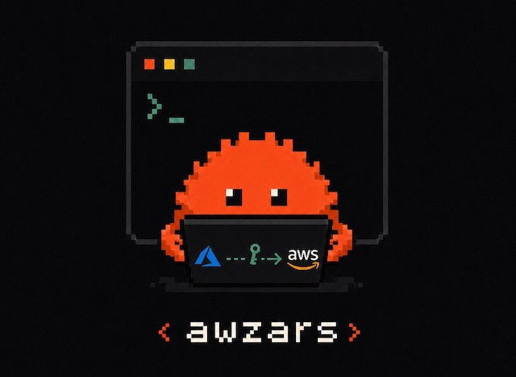

# awzars

<p align="center">
  
</p>

A Rust alternative to [aws-azure-login](https://github.com/aws-azure-login/aws-azure-login) for the same job: Azure AD / Entra ID single sign-on into AWS.

Automates Azure AD authentication and exchanges SAML assertions for AWS
temporary credentials via the AWS CLI `credential_process` protocol — as a
single ~15 MB static musl-linked binary with no Node.js, no `node_modules`,
and no GLIBC dependency. Runs unmodified on Alpine, distroless, and any
glibc host.

## Origin

awzars was built by reading the original
[aws-azure-login](https://github.com/aws-azure-login/aws-azure-login) (Node.js,
Puppeteer-based) source tree end to end with Claude Opus 4.6–4.7 (Anthropic's
coding model) and re-expressing the same SAML federation flow in idiomatic Rust.

The Azure SAML AuthnRequest construction, the role-extraction parsing, and the
overall login pipeline shape follow the original's behavior. The storage,
cryptography, browser-automation, and terminal-UI layers are written from
scratch in Rust.

awzars is a sibling project, not a fork or a drop-in swap — aws-azure-login
remains the mature, widely-deployed option.

## Why you might pick awzars

| Dimension | aws-azure-login | awzars |
|---|---|---|
| Runtime | Node.js + `node_modules` (~100 MB) | Single static binary (~15 MB, musl) |
| Browser | Puppeteer (bundles its own Chromium) | chromiumoxide (uses system Chrome) |
| TLS | OpenSSL (system) | rustls + aws-lc-rs (vendored) |
| AWS SDK | `aws-sdk` v2 (JS) | official `aws-sdk-sts` (Rust) |
| Credential storage | Plaintext file (`~/.aws/credentials`) | OS keyring (macOS Keychain / Linux Secret Service) |
| Cold-start latency | ~2 s (Node.js + V8 warm-up) | ~50 ms |
| Installation | `npm install -g` | `cp` one binary |
| Memory zeroing | Best-effort GC | `zeroize` (Drop-based) on every secret |
| Cookie persistence | n/a (or plaintext) | ChaCha20-Poly1305 with rotating keyring-backed keys |
| AI-agent fence | n/a | Opt-in per-profile password lock + `CLAUDECODE` / `AI_AGENT` consent gate |
| TUI config manager | n/a | `awzars tui` (full CRUD on `<config-dir>/config.toml` and `~/.aws/config`) |
| Headless re-auth | Manual flag plumbing | Automatic in `credential-process` via saved cookies |
| Remote Chrome | Limited | `CHROME_REMOTE_URL`; `ws://` only behind an explicit flag (`wss://` not usable yet, see [Remote Chrome](#remote-chrome)) |

## Honest tradeoffs

- **Younger codebase.** aws-azure-login has years of production miles across
  many Azure tenant configurations. awzars handles the common federation
  setups but you may hit edge cases (custom Conditional Access policies,
  unusual MFA providers, exotic SAML claim shapes) that the original has
  already absorbed. If awzars trips on your tenant, aws-azure-login is the
  pragmatic fallback.
- **No client-side XML-DSIG verification** of the SAML assertion. Integrity is
  delegated to TLS-to-Azure plus AWS STS re-verification inside
  `AssumeRoleWithSAML`. This matches aws-azure-login's behavior, but a
  client-side check would still be additional defense in depth, and a vetted
  Rust XML-DSIG implementation is not yet available.
- **System Chrome required.** awzars does not bundle Chromium (deliberately —
  bundling would defeat the static-binary value proposition). You need a
  Chrome, Chromium, or Edge install on the host, or a remote Chrome via
  `CHROME_REMOTE_URL`.
- **Linux-first start-time binding.** A terminal-session unlock token records
  the session leader's start time from `/proc/<sid>/stat` on Linux. On macOS
  it is read with `proc_pidinfo`, which usually cannot read the root-owned
  `login` session leader, so there the token relies on the session id, the
  boot binding and the TTL (documented in `SECURITY_AUDIT.md` as `L-2`).
- **macOS (Apple Silicon) and Linux only.** Windows is not supported yet.
- **No Node.js plugin ecosystem.** If your workflow extends aws-azure-login
  via a Node.js wrapper, you'll need to re-shape that integration around the
  CLI surface.

## Migrating from aws-azure-login

awzars and aws-azure-login can coexist on the same machine pointing at the
same `~/.aws/config` — the two never share state, so you can flip one
profile at a time and roll back by editing the `credential_process` line.

| aws-azure-login | awzars equivalent |
|---|---|
| `aws-azure-login --configure --profile work` | `awzars configure --profile work` |
| `aws-azure-login --profile work` | `awzars login --profile work` |
| `aws-azure-login --no-prompt --profile work` | `awzars login --headless --remember-me --profile work` |
| `credential_process = aws-azure-login --no-prompt --profile work` (in `~/.aws/config`) | `credential_process = /usr/local/bin/awzars credential-process --profile work` |
| Stored credentials in `~/.aws/credentials` | Stored in OS keyring (`awzars clear-cache` to drop, `awzars delete-profile` for a full wipe) |

## AI security review

This codebase was reviewed by two LLMs as a defense-in-depth complement to the
human review:

- **Anthropic Claude Opus 4.7** — primary code author; ran a full read-through
  of credential, cookie, config, browser, SAML, lock, and AWS-config write
  paths.
- **OpenAI GPT-5.5** — independent security check (second pass alongside Opus
  4.7) via the Codex CLI.

Both checked the documented threat model — see
[`SECURITY_AUDIT.md`](SECURITY_AUDIT.md) for the full scope and current
findings:

- **No** critical, high, medium, or low exploitable issues identified.
- Accepted residual risks (M-2: failure-counter is same-UID resettable;
  L-2: start-time binding is Linux-first; L-8: `config.toml` follows symlinks
  inside the `0o700` config dir; L-9: unlock scope under AI agents) — each
  documented with the threat-model reasoning for accepting them.

The audit covers the Rust source. Chromium runtime exploitation,
rustls/ring/aws-lc-rs primitives, and OS-keyring implementations are out of
scope and delegated to their upstreams.

LLM review complements but does not replace human review or formal audit.

## Build from source

awzars is a single Cargo workspace with no `build.rs` magic and no system
package dependencies on the static-build path. The default release target
is a static musl-linked Linux binary; native builds on macOS and glibc Linux
work too and are convenient for development.

**Supported platforms:** macOS on Apple Silicon (arm64; Intel macOS is not
supported) and Linux (glibc, or
the static musl build). Windows is not supported yet: the session-lock code
uses Unix-only APIs (`nix` termios and `getsid`), so the crate does not build
for Windows, and CI does not build it.

### 1. Get the source

```bash
git clone https://github.com/moyataka/awzars
cd awzars
```

### 2. Install the Rust toolchain

```bash
curl --proto '=https' --tlsv1.2 -sSf https://sh.rustup.rs | sh
rustup toolchain install stable      # 1.91.1 or newer (required by the AWS SDK crates in Cargo.lock)
```

### 3a. Static musl build (recommended for distribution)

`cargo-zigbuild` + `zig` is the lightest path — no Docker, no cross-libc
toolchain. The output is the same ~15 MB statically-linked binary that
runs on Alpine, distroless, and any glibc host without modification.

```bash
# One-time tooling install
pip install ziglang cargo-zigbuild
rustup target add x86_64-unknown-linux-musl

# Build
cargo zigbuild --release --target x86_64-unknown-linux-musl

# Test
cargo zigbuild --test '*' --target x86_64-unknown-linux-musl

# Output
ls -lh target/x86_64-unknown-linux-musl/release/awzars
file   target/x86_64-unknown-linux-musl/release/awzars   # → "statically linked"
```

For aarch64 hosts (Apple Silicon, ARM servers), substitute
`aarch64-unknown-linux-musl` everywhere above.

### 3b. Native development build

For day-to-day development on macOS or glibc Linux, a plain
`cargo build` is fastest — it picks up your host's linker and skips the
musl toolchain entirely.

```bash
cargo build              # debug build
cargo build --release    # optimized
cargo run -- login       # build + run in one step
cargo test               # run the test suite
```

**Native build prerequisites by host:**

- **macOS** — Xcode Command Line Tools (`xcode-select --install`). No
  Homebrew packages needed; `keyring-rs` uses the `Security.framework`
  bindings shipped with the OS.
- **Linux (glibc)** — `gcc` or `clang`. The vendored `libdbus` (pulled in
  for the Secret Service keyring backend) compiles from source as part
  of the cargo build, so you do **not** need `libdbus-1-dev` installed.

### 4. Verify the build

```bash
./target/release/awzars --version
./target/release/awzars --help

# For the musl build, confirm the static-linkage promise:
ldd target/x86_64-unknown-linux-musl/release/awzars
# → "not a dynamic executable"
```

### 5. Quality gates run in CI

CI runs these for every push and pull request to `dev` and `main` (and
weekly): `cargo fmt` on Linux, clippy and tests on Linux and macOS, plus a
static musl build and `cargo deny`. Windows is not built in CI yet.

```bash
cargo fmt --check
cargo clippy --all-targets -- -D warnings
cargo test --all-targets
cargo deny check          # advisories, licences, bans (openssl, native-tls), sources
```

Before opening an issue or pull request, read [CONTRIBUTING.md](CONTRIBUTING.md).

## Install

### Pre-built binary

Each snippet resolves to the latest release that actually ships that
platform's asset, so a release containing only one of the two binaries is
handled correctly.

**macOS (Apple Silicon M1/M2/M3)**

```bash
URL=$(curl -fsSL https://api.github.com/repos/moyataka/awzars/releases \
  | grep '"browser_download_url".*aarch64-apple-darwin' \
  | head -1 | cut -d'"' -f4)
[ -n "$URL" ] || { echo "no macOS Apple Silicon asset in recent releases"; exit 1; }
curl -fsSL "$URL" | tar -xz
sudo install -m 0755 awzars /usr/local/bin/awzars
```

**Linux x86\_64 (static, no GLIBC dependency)**

```bash
URL=$(curl -fsSL https://api.github.com/repos/moyataka/awzars/releases \
  | grep '"browser_download_url".*x86_64-unknown-linux-musl' \
  | head -1 | cut -d'"' -f4)
[ -n "$URL" ] || { echo "no Linux x86_64 musl asset in recent releases"; exit 1; }
curl -fsSL "$URL" | tar -xz
sudo install -m 0755 awzars /usr/local/bin/awzars
```

The Linux musl binary runs unmodified on Alpine, distroless, and any glibc host.

### How releases are built

Releases are built by GitHub Actions, not on a maintainer's machine. Pushing
a `vX.Y.Z` tag on `main` runs
[`.github/workflows/release.yml`](.github/workflows/release.yml), which:

1. checks that the tag matches the version in `Cargo.toml` and runs the tests;
2. builds the macOS (Apple Silicon) binary natively and the static Linux
   binary with `cargo zigbuild`;
3. packages each as `awzars-vX.Y.Z-<target>.tar.gz` (just the `awzars`
   binary), writes `SHA256SUMS` and records a
   [build provenance attestation](https://docs.github.com/en/actions/concepts/security/artifact-attestations)
   for each archive;
4. creates a **draft** release with the notes from `CHANGELOG.md`. A
   maintainer reviews it and publishes it.

The macOS binary is not signed or notarized.

### Verify a download

Download the archive and `SHA256SUMS` from the release page, then check the
checksum and, with the [GitHub CLI](https://cli.github.com/), the provenance:

```bash
TAG=vX.Y.Z
ASSET=awzars-$TAG-x86_64-unknown-linux-musl.tar.gz   # or awzars-$TAG-aarch64-apple-darwin.tar.gz
curl -fsSLO "https://github.com/moyataka/awzars/releases/download/$TAG/$ASSET"
curl -fsSLO "https://github.com/moyataka/awzars/releases/download/$TAG/SHA256SUMS"
shasum -a 256 -c SHA256SUMS --ignore-missing
gh attestation verify "$ASSET" --repo moyataka/awzars \
  --signer-workflow moyataka/awzars/.github/workflows/release.yml \
  --source-ref "refs/tags/$TAG"
```

With these flags, `gh attestation verify` checks that this exact archive was
attested by the `release.yml` workflow of `moyataka/awzars`, in a run started
by the `$TAG` tag. It shows where and from which tag the archive was built,
not that the code is correct.

Releases up to v1.0.4 were built by hand and have no attestation (only v1.0.4
ships a `SHA256SUMS`).

### From source

After building (see **Build from source** above):

```bash
# System-wide
sudo install -m 0755 target/x86_64-unknown-linux-musl/release/awzars /usr/local/bin/awzars

# Per-user, no sudo
install -m 0755 -D target/x86_64-unknown-linux-musl/release/awzars ~/.local/bin/awzars
```

### Verify

```bash
awzars --version
awzars --help
```

## Use

### Quickstart

```bash
awzars configure                          # 1. set tenant ID, app ID URI, role ARN
awzars login --remember-me                # 2. log in via browser, persist the session
printf '[profile work]\ncredential_process = /usr/local/bin/awzars credential-process --profile work\n' >> ~/.aws/config
aws s3 ls --profile work                  # 3. AWS CLI now refreshes credentials silently
```

### 1. Configure a profile

```bash
awzars configure
```

Prompts for Azure AD tenant ID, app ID URI, optional default role ARN, and session duration; writes `<config-dir>/config.toml` (mode `0o600` on Unix). See [Configuration](#configuration) for your platform's directory.

### 2. Login

```bash
awzars login
```

Opens a browser, performs Azure AD login (MFA supported), extracts the SAML
assertion, calls `AssumeRoleWithSAML`, and caches the resulting AWS
credentials in the OS keyring + in-memory cache.

Cached credentials refresh when 15 minutes or less remain, matching the AWS
SDK's advisory refresh window. Sessions shorter than 30 minutes use half the
session duration instead, so a 15-minute session is reused from the cache
until 7.5 minutes remain. Session duration defaults to the profile's setting
(one hour if unset); `--session-duration` overrides it and forces a fresh
login. Cached credentials are always judged by the profile's session duration,
even when they came from a login with a different `--session-duration`.

`AWZARS_AZURE_TENANT_ID` and `AWZARS_AZURE_APP_ID_URI` supply defaults for
`--azure-tenant` and `--azure-app` in login and configure. Explicit flags take
precedence. The common Azure SDK variables `AZURE_TENANT_ID` and
`AZURE_APP_ID_URI` are ignored.

Login overrides (`--role-arn`, `--azure-tenant`, or `--azure-app`) always
authenticate afresh. Their credentials are returned for that invocation only;
the profile's cached credentials and saved role remain unchanged.

If the profile's saved `role_arn` is no longer in the SAML assertion (for
example, the role was renamed), an interactive `login` warns and opens the
role picker; when only one role remains it asks y/N before using it. It then
asks whether to save the chosen role to the profile (default No). If you
decline, the credentials serve that login only and nothing is stored. A role
passed with `--role-arn` is never replaced. Without a terminal
(`credential-process`, `login --credential-process`, or piped stdin/stdout)
the command fails with exit code `3`, lists up to five of the closest
available roles, and says how to fix the profile. `awzars list-roles` shows
every role and notes when the configured one is missing.

Useful flags:

```bash
awzars login --role-arn arn:aws:iam::123456789012:role/MyRole   # skip role selector
awzars login --force-refresh                                    # bypass cache
awzars login --remember-me                                      # persist browser session
awzars login --headless --remember-me                           # silent re-auth using saved session
awzars login --output json                                      # machine-readable output
awzars login --session-remember                                 # persist AI consent for this shell (default: ask each call)
awzars login --show-secrets                                     # debug only — see warning below
```

> **`--show-secrets` warning.** Prints live access keys to stdout (shell scrollback, paste buffer, `tmux`/`screen` logs). Use only for hand-debugging — wire AWS CLI through `credential-process` for normal use.

### 3. Wire up the AWS CLI

Add to `~/.aws/config`:

```ini
[profile work]
credential_process = /usr/local/bin/awzars credential-process --profile work
region = us-east-1
```

Then use the AWS CLI normally — awzars is invoked transparently and refreshes silently using saved session cookies:

```bash
aws s3 ls --profile work
aws ec2 describe-instances --profile work
```

Requires `awzars login --remember-me` once first to establish the persistent browser session.

### TUI config manager

```bash
awzars tui
```

Full-screen terminal UI (ratatui) with two tabs:

- **awzars profiles** (`<config-dir>/config.toml`) — full CRUD
- **AWS config** (`~/.aws/config`) — full CRUD for awzars-linked profiles,
  edit-only for others (SSO / static / assume-role)

Key bindings: `↑/↓/j/k` navigate, `a` add, `e`/`Enter` edit, `d` delete,
`Tab`/`Shift+Tab` switch tabs, `Ctrl+S` save, `Ctrl+D` clear focused field,
`Esc` cancel, `q` quit.

Adding or renaming to an existing name is rejected. Existing awzars profile
names are read-only because browser sessions, password locks, and AWS links
belong to that name. To change one, clone the profile under a new name, set
its password lock if needed, update the AWS links, and then delete the old
profile to clean up its saved state.

Assume-role profiles (`source_profile` + `role_arn`) get a dedicated form
that exposes `role_session_name` alongside the source-profile autocomplete,
so the entry written into `~/.aws/config` is complete without a follow-up
hand-edit.

### Profile lock (optional, opt-in)

```bash
awzars --profile work set-password                  # require a password for credential ops on profile "work"
awzars --profile work unlock                        # unlock for the current terminal session (default 8h TTL)
awzars --profile work unlock --allow-ai             # also allow AI agents in this session to use it
awzars --profile work unlock --ttl-hours 24         # raise the TTL (soft cap 24h)
awzars --profile work unlock --ttl-hours 72 --allow-long-ttl  # opt-in beyond 24h, hard cap 720h (30 days)
awzars --profile work unlock --no-expire            # no time limit (see below)
awzars --profile work lock                          # drop this session's unlock token
awzars --profile work set-password --remove         # disable the lock (still needs old password)
```

The lock fences `login`, `credential-process`, and `list-roles` behind a
session-scoped checkpoint. Designed to stop AI agents (Claude Code, Cursor,
etc.) from autonomously invoking AWS commands without an explicit human
checkpoint. See **Hardening against AI agents** below for the threat model
and limits.

An unlock is a small token file. It lives in `$XDG_RUNTIME_DIR/awzars/sessions/`
when that variable is set (cleared at logout where it is a tmpfs), otherwise
in the user cache directory: `~/Library/Caches/com.awzars.awzars/awzars/sessions/`
on macOS and `${XDG_CACHE_HOME:-~/.cache}/awzars/awzars/sessions/` on Linux.
A token counts only:

- in the session scope that created it: `AWZARS_SESSION_ID` if set, else the
  Claude Code conversation (`CLAUDE_CODE_SESSION_ID`), else the terminal
  session, found by walking up to the nearest ancestor process that owns a
  terminal (`/proc` on Linux, `proc_pidinfo` on macOS);
- in the boot it was created in. If the current boot cannot be identified,
  session unlock is unavailable and gated commands exit with code `11`;
- while the profile keeps the password lock it was created under. Setting,
  changing or removing the password, and `delete-profile`, remove the
  profile's tokens in every session.

Tokens written before 1.0.4 are not honoured; run `unlock` again after
upgrading. `--no-expire` removes only the time limit: the token still ends at
reboot, a terminal-session token ends with that terminal session, and tokens
under `$XDG_RUNTIME_DIR` go at logout.

### Other commands

```
awzars list-roles         # list available AWS roles (interactive role browser)
awzars clear-cache        # drop the profile's stored credentials; keeps the remembered browser session (prompts; --yes to skip)
awzars delete-profile     # drop awzars profile + keyring entries + cookies (does NOT touch ~/.aws/config)
awzars completions fish   # print a shell completion script (bash, zsh, fish, powershell)
```

### Shell completion

`awzars completions <shell>` prints a completion script for subcommands and
flags. It does not complete profile names. Install it once per shell, and
again after upgrading awzars so new flags show up.

fish:

```fish
awzars completions fish > ~/.config/fish/completions/awzars.fish
```

bash, with the bash-completion package:

```bash
mkdir -p ~/.local/share/bash-completion/completions
awzars completions bash > ~/.local/share/bash-completion/completions/awzars
```

Without bash-completion, add `eval "$(awzars completions bash)"` to `~/.bashrc`.

zsh:

```zsh
mkdir -p ~/.zfunc
awzars completions zsh > ~/.zfunc/_awzars
```

Then make sure `~/.zshrc` has these lines, with the `fpath` line before
`compinit`:

```zsh
fpath=(~/.zfunc $fpath)
autoload -Uz compinit && compinit
```

PowerShell (`pwsh`): add this line to the file named by `$PROFILE`:

```powershell
awzars completions powershell | Out-String | Invoke-Expression
```

### Global flags

These work on every subcommand:

| Flag | Effect |
|---|---|
| `--profile <name>` | Pick an awzars profile (default: `default`) |
| `-v` / `-vv` / `-vvv` | Tracing verbosity: `info` / `debug` / `trace` |
| `--quiet` | Suppresses status text, text/table results, and logs below error; overrides `-v` and `RUST_LOG`. JSON output, required prompts, and the requested TUI remain available. |
| `--config-dir <path>` | Use an absolute configuration directory; takes precedence over `AWZARS_CONFIG_DIR` |
| `--output text\|json\|table` | Output shape for `login` and `list-roles` |

### Exit codes

For wrappers and shell scripts:

| Code | Meaning |
|---|---|
| `0` | Success, or user quit (e.g. `q` in the role selector / TUI) |
| `1` | Generic IO / serialization failure |
| `2` | Config error (missing profile, malformed `config.toml`) |
| `3` | Azure / SAML auth failure, or the requested role is not in the SAML assertion |
| `4` | Browser or network failure |
| `5` | AWS STS / keyring / cache failure, or the refresh-lock wait timed out |
| `6` | TUI / dialog failure |
| `7` | Profile is password-locked and not unlocked in this session |
| `8` | AI agent context detected without consent |
| `9` | Password verification failed |
| `10` | Lock operation needed a TTY but stdin isn't one |
| `11` | Session unlock unavailable: the current boot session cannot be identified |

## Remote Chrome

For CI, headless servers, or when you want Chrome on a different machine than
awzars, set `CHROME_REMOTE_URL` to a Chrome DevTools Protocol WebSocket URL.
`wss://` is required by default; `ws://` needs `--allow-insecure-remote-chrome`
and prints a warning.

> **Current limitation:** the WebSocket client in this build has no TLS
> support, so a `wss://` URL passes the check above but the connection fails.
> Remote Chrome works only over `ws://` with `--allow-insecure-remote-chrome`
> (for `credential-process`, the flag or the profile's
> `allow_insecure_remote_chrome = true`). The sign-in traffic is then
> unencrypted, so keep the connection on loopback, for example through an
> SSH tunnel. `list-roles` has no such flag and cannot use a remote Chrome.

On macOS, start Chrome with a separate profile:

```bash
/Applications/Google\ Chrome.app/Contents/MacOS/Google\ Chrome \
  --remote-debugging-port=9222 \
  --user-data-dir="/tmp/chrome_dev_session" \
  --no-first-run \
  --no-default-browser-check \
  "about:blank"
```

This opens a visible Chrome window. Its launch command controls whether remote
Chrome is headless; awzars's `--headless` only affects locally launched Chrome.
Keep the profile directory to retain the remote session; `/tmp` may be cleaned.
After restarting Chrome, fetch `/json/version` again and update
`CHROME_REMOTE_URL` with its new `webSocketDebuggerUrl`.

On a Linux Chrome host:

```bash
chromium --remote-debugging-port=9222 --user-data-dir="/tmp/chrome_dev_session"
```

On the awzars host, tunnel the port and read the `webSocketDebuggerUrl`:

```bash
ssh -N -L 9222:localhost:9222 user@chrome-host &
curl http://localhost:9222/json/version
export CHROME_REMOTE_URL="ws://localhost:9222/devtools/browser/<id>"
awzars login --remember-me --allow-insecure-remote-chrome
```

After a successful `--remember-me` login via local or remote Chrome, session
cookies are saved locally (encrypted). Local headed and headless logins reuse
this store; a remembered login refreshes it, including after expired cookies
require an interactive sign-in. Unset `CHROME_REMOTE_URL` to make subsequent
`awzars credential-process` refreshes use **local** headless Chrome with those
cookies. While the variable remains set, refreshes continue using remote
Chrome and require their own `--allow-insecure-remote-chrome` flag or the
profile's `allow_insecure_remote_chrome = true` setting for `ws://`.

See `CLAUDE.md` for full SSH-port-forward variants (Chrome on macOS, awzars on
Linux, etc.).

## Configuration

`<config-dir>` means the resolved awzars configuration directory:

| Platform | Default configuration directory |
|---|---|
| Linux | `$XDG_CONFIG_HOME/awzars` when the variable is an absolute path; otherwise `~/.config/awzars` |
| macOS | `~/Library/Application Support/com.awzars.awzars` |
| Windows (not supported yet) | `%APPDATA%\awzars\awzars\config` would apply once Windows is supported |

These paths come from `ProjectDirs::from("com", "awzars", "awzars")`.
`--config-dir <absolute-path>` takes precedence over `AWZARS_CONFIG_DIR`,
which takes precedence over the platform default. `~/.awzars` is only used
if selected explicitly through an override. The AWS configuration file is
separate: `aws_config_path` overrides `AWS_CONFIG_FILE`, which overrides
its usual `~/.aws/config` location.
In both, a leading `~/` is expanded to the home directory, and a relative
path resolves against the current working directory.

```text
<config-dir>/                     awzars settings and browser state
|-- config.toml                   profiles and preferences
|-- refresh-<profile>.lock        coordinates credential refreshes
`-- chromium/<profile>/          remembered browser data
    `-- cookies.enc              encrypted session cookies
```

`refresh-<profile>.lock` makes concurrent `login` and `credential-process`
calls for the same profile refresh one at a time, so only one of them opens a
browser. Calls with valid cached credentials return without waiting for it,
and `login` prompts (remember-me, role selection) run outside it. A call that
must wait gives up after 60 seconds with a message saying another login or
refresh is in progress; set `AWZARS_REFRESH_LOCK_TIMEOUT_SECS` to a positive
whole number of seconds to change that limit. The lock file is never deleted.

The directory has mode `0o700` and `config.toml` has mode `0o600` on Unix.
Example `<config-dir>/config.toml`:

```toml
aws_config_path = "~/.aws/config"   # optional; overrides AWS_CONFIG_FILE for AWS profile editing and orphan checks

[profiles.default.azure]
tenant_id = "00000000-0000-0000-0000-000000000000"
app_id_uri = "https://signin.aws.amazon.com/saml"

[profiles.work]
role_arn = "arn:aws:iam::123456789012:role/MyRole"
[profiles.work.azure]
tenant_id = "11111111-1111-1111-1111-111111111111"
app_id_uri = "https://signin.aws.amazon.com/saml"
session_duration = 3600
```

Use the same override on each invocation, including the command saved in
AWS `credential_process`, when using a custom awzars configuration directory.

## Troubleshooting

**Login fails with "Secret Service: unlock prompt was dismissed".**
The OS keyring could not be unlocked, so the AWS credentials could not be
saved. Unlock it in the session running awzars, then retry the login. See
[Headless / SSH keyring unlock](docs/headless-keyring.md) for Fish commands
and guidance on the separate remote Chrome permission used by AWS refreshes.

**`--headless` fails with "no persistent browser session found".**
Headless mode reuses cookies from a prior interactive `--remember-me`
login or from a remote Chrome session. Run `awzars login --remember-me`
once interactively first, then headless re-auth works for the lifetime
of the cookies.

**SingletonLock / "another Chrome is using this profile".** If a Chrome
instance is already holding the persistent user-data-dir, awzars falls
back to a temp directory and injects the saved cookie store
(`cookies.enc`) into it. If that fallback also fails, quit the other
Chrome (or run it under a different `--user-data-dir`) and retry.

**`CHROME_REMOTE_URL` is rejected or does not connect.** A `ws://` URL is
rejected unless `--allow-insecure-remote-chrome` is passed. A `wss://` URL
passes that check but cannot connect in the current build (the WebSocket
client has no TLS support). Use `ws://` with the flag over a loopback or
SSH-tunnelled connection; see [Remote Chrome](#remote-chrome).

**`credential-process` errors out with "No persistent browser session
found for profile".** Same root cause as the first item — run
`awzars login --remember-me` once before wiring the AWS CLI integration,
so a persistent session exists for silent refreshes.

## Security

- **No SAML on disk.** Assertions live in `Zeroizing<String>` and are dropped
  before any persistence.
- **OS keyring at rest.** AWS credentials and the cookie encryption key are
  stored in Keychain (macOS) or Secret Service (Linux) via `keyring-rs`. A
  keychain read error (locked keychain, denied access) is reported as an
  error rather than treated as a missing entry, so existing keys are not
  regenerated.
- **Memory zeroing.** Every sensitive type implements `Zeroize` and is wiped
  on drop. A panic hook restores raw mode / alternate screen / cursor /
  mouse capture and wipes the cookie-key cache before the default handler
  runs — necessary because release builds use `panic = "abort"`, which
  skips Drop impls.
- **Pinned password-hash parameters.** The optional profile lock uses
  Argon2id with `m = 64 MiB`, `t = 3`, `p = 4` (well above the crate's
  defaults). A regression test pins the PHC string prefix so a silent
  downgrade fails CI.
- **Lock failure backoff.** Wrong-password attempts hit an on-disk
  per-(session, profile) counter and sleep `2 / 4 / 8 / 16 / 32 / 60 / 60 s`
  capped. Counters age out after an hour of quiet so a typo last week
  doesn't penalize today's first attempt.
- **Unlock-token binding.** Session unlock tokens are bound to their
  session scope, to the current boot (`/proc/sys/kernel/random/boot_id` on
  Linux, `kern.bootsessionuuid` on macOS; without a boot id session unlock
  is refused), and to a fingerprint of the profile's current lock verifier.
  Terminal-session tokens also record the session leader's start time
  (always on Linux, best-effort on macOS), so a recycled session id does not
  inherit a stale token. A token that fails any check is refused.
- **TLS 1.2+ via rustls.** No OpenSSL anywhere on the credential path.
- **Atomic writes with `O_EXCL | O_NOFOLLOW`.** Every persisted secret
  (`config.toml`, `cookies.enc`, unlock tokens, `~/.aws/config`) goes through
  `util::atomic_write`, which defeats same-UID symlink-planting.
- **Size caps on parsed input.** SAML assertions are rejected before decode
  past 256 KB, `config.toml` reads cap at 1 MiB, and the unlock-token GC
  reads each candidate file with an 8 KiB limit so a planted
  multi-gigabyte file in the session dir cannot OOM the GC pass.
- **Cookie key rotation.** ChaCha20-Poly1305 keys rotate every 30 days, old
  keys garbage-collected after 90 days. The keystore is one keyring item per
  profile, so macOS Keychain ACL is granted once and rotation never
  re-prompts.
- **CI runs `cargo fmt --check`, `clippy -D warnings`, tests and `cargo deny check`**
  (RustSec advisories, licences, banned crates) on every PR, and weekly.

Full threat model and accepted residual risks are in
[`SECURITY_AUDIT.md`](SECURITY_AUDIT.md).

To report a vulnerability, follow [`SECURITY.md`](SECURITY.md).

### Hardening against AI agents in the same shell

awzars's built-in AI-consent gate refuses credential operations when
`CLAUDECODE` or `AI_AGENT` is set in the environment. This stops *casual*
leakage (you forgot you'd unlocked, then opened Claude Code in the same
shell). It does **not** stop an adversarial AI that runs `unset CLAUDECODE`
before invoking `awzars`.

The load-bearing layer for the adversarial case is the AI tool's own
permission system. For Claude Code, drop one of these into
`~/.claude/settings.json`:

```json
{
  "permissions": {
    "deny": ["Bash(awzars credential-process *)"]
  }
}
```

Or require explicit human approval on every call:

```json
{
  "permissions": {
    "ask": ["Bash(awzars credential-process *)"]
  }
}
```

## Requirements

- macOS on Apple Silicon or Linux (Windows is not supported yet)
- Chrome, Chromium, or Edge (local) — or a remote Chrome via `CHROME_REMOTE_URL`
- Azure AD / Entra ID with AWS federation configured
- AWS IAM Identity Provider for the Azure AD app

## License

MIT. See [LICENSE](LICENSE).

## Acknowledgements

- [aws-azure-login](https://github.com/aws-azure-login/aws-azure-login) — the
  Node.js project that pioneered this flow and informed the Rust
  implementation. Thanks to its maintainers for years of edge-case handling
  that this project benefits from indirectly.
- [chromiumoxide](https://github.com/mattsse/chromiumoxide), [rustls](https://github.com/rustls/rustls), [ratatui](https://github.com/ratatui-org/ratatui), [keyring-rs](https://github.com/hwchen/keyring-rs) — load-bearing dependencies.
